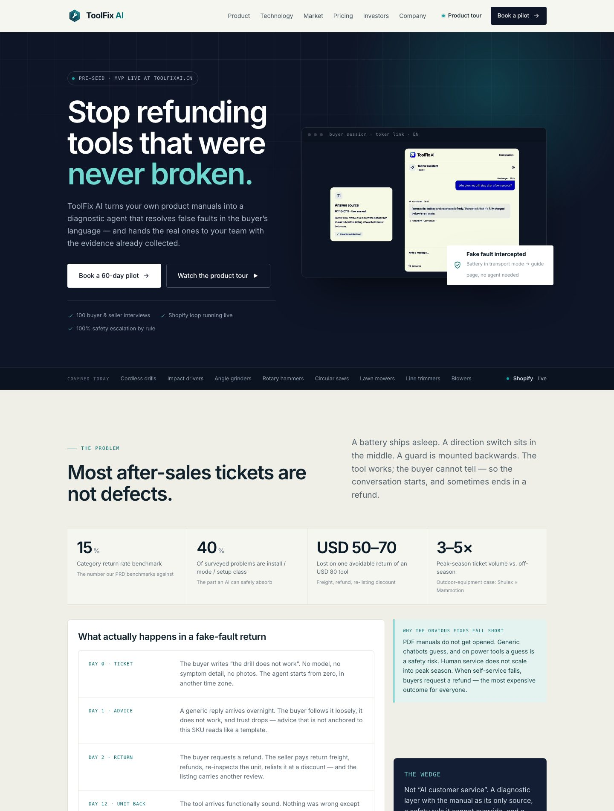
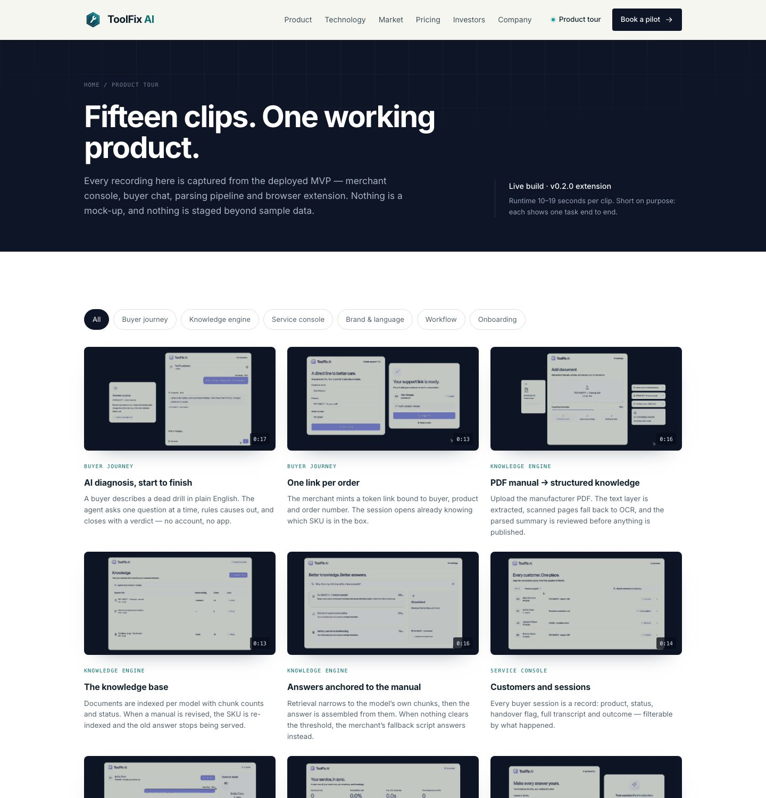

# ToolFix AI — marketing site





Static marketing site for **ToolFix AI**, a vertical AI after-sales diagnostics platform for
power-tool brands selling across borders. Twelve pages, fifteen recorded product clips, and no
runtime dependencies.

- **Live:** https://panpan01bit.github.io/toolfix-ai-website/
- **Product:** https://www.toolfixai.cn

## What is here

| Path | Page |
| --- | --- |
| `/` | Home — the problem, the diagnostic loop, evidence, market, pricing entry |
| `/product/` | Platform — buyer session, guide pages, knowledge engine, handover, console |
| `/technology/` | Architecture, RAG pipeline, safety rule, data model, security, acceptance gates |
| `/demo/` | Product tour — 15 filterable recordings of the deployed build |
| `/pricing/` | Four plans, comparison table, ROI calculator, pilot process, billing FAQ |
| `/market/` | Bottom-up sizing, segments, competition, GTM, unit economics, risks |
| `/investors/` | What is proven vs assumed, why now, milestones, use of funds, data room |
| `/company/` | Origin story, founders, operating principles, research method |
| `/faq/` | 30 questions across product, safety, data, commercial and stage |
| `/zh/` | 中文简介 — one-page Chinese overview for domestic partners |
| `/privacy/`, `/terms/` | Site policies |

## Build

No dependencies, Node 18+.

```sh
node build.mjs            # writes dist/
node build.mjs --serve    # builds, then serves on http://127.0.0.1:4173/
```

Environment:

- `SITE_BASE` — deployment sub-path (default `/`). Production sets `/toolfix-ai-website/`.
- `SITE_ORIGIN` — canonical origin for sitemap and absolute URLs.
- `ONLY=index,product` — build a subset of pages while iterating.

Output is plain HTML with one fingerprinted CSS file and one fingerprinted JS file, plus
`<page>/index.html` pretty URLs so every route works as a static page on GitHub Pages.

## Structure

```
build.mjs                 static site generator (no deps)
src/lib/layout.mjs        page shell, header, footer, logo, icon set
src/lib/ui.mjs            section, button, stats, video, table, bar chart helpers
src/lib/data.mjs          product clips, plans, FAQ, survey data, competitors, financials
src/pages/*.mjs           one module per page, exporting { path, title, nav, body }
src/styles/main.css       design system
src/client/site.js        nav, filters, lightbox, accordion, search, ROI calculator
scripts/encode-videos.sh  turns the green-screen product recordings into web clips
scripts/shot.mjs          headless-Chrome screenshot driver used for visual QA
public/                   media, images, fonts
```

## Product recordings

The source material was fifteen green-screen `.mov` captures (1462×806, 120 fps). The encoder:

1. trims the one-second fade-in,
2. keys the flat green backdrop (`colorkey`) and grades the dim UI for legibility,
3. crops to the app window and composites on the site surface colour `#0E1526`,
4. exports H.264 MP4 (1440×794, 30 fps, CRF 23, faststart, no audio) plus a poster frame;
5. cuts short `loop-*` and `hero-loop` versions that begin at the busiest moment, so inline panels never open on an empty screen.

Re-run with `./scripts/encode-videos.sh` after editing the clip table in that script.

## Claims and sourcing

Figures on the site come from the founders' business plan, the 100-response survey, the product
PRD and the deployed build. Projections are labelled as base-case estimates; the site includes a
short disclaimer on the Investors page and in the footer. Product clips use demonstration data.

## Deploy

`.github/workflows/deploy.yml` builds on every push to `main` and publishes `dist/` to GitHub
Pages. Repository Settings → Pages → Source must be **GitHub Actions**.
